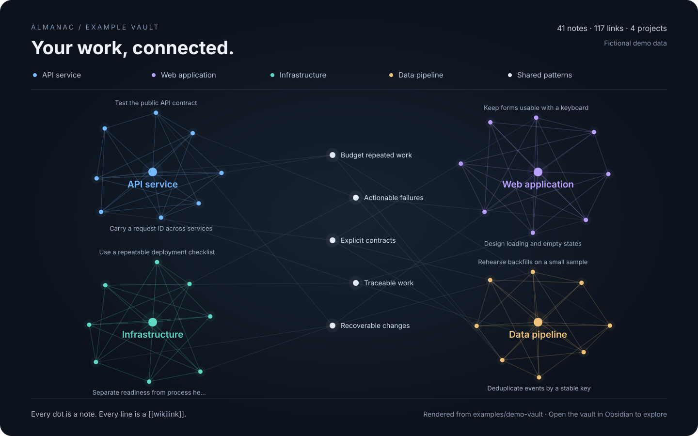

# Almanac

[](https://github.com/AndriGitDev/almanac/actions/workflows/ci.yml)
[](LICENSE)

**Persistent memory for your coding agents, stored as Markdown files you own.**

Almanac saves useful knowledge from your coding sessions and makes it available when you need it again. Decisions, bug fixes, project conventions, and unfinished work can carry over to the next session—even when you switch agents or machines.

For example, your agent can look up:

- “Why did we choose this database?”
- “Have we fixed this error before?”
- “What should I know before changing this file?”
- “Where did we leave off yesterday?”

Your knowledge lives in a **vault**: a folder of readable Markdown notes, linked together and tracked in Git. You can edit it yourself, browse it in Obsidian, or search it from an agent or the terminal.

[Get started](#get-started) · [Choose an integration](#choose-an-integration) · [Features](#features) · [Documentation](#documentation)

[](examples/demo-vault)

*A populated example vault: each dot is a note, and each line is a link between notes. [Explore the demo in Obsidian](examples/demo-vault) or browse its Markdown files. This illustration uses fictional notes and is not an Obsidian screenshot.*

## How it works

1. **Capture useful work.** At the end of a supported session, Almanac records a short activity entry. Substantial sessions with new insights can produce focused notes about what you learned. You can also save something explicitly.
2. **Bring it back when relevant.** Search your past work, or use an integration that supplies project context at session start, before a prompt, and when reading a file.
3. **Keep the knowledge useful.** Link related notes, track which conclusions have changed, and optionally consolidate recurring patterns or archive stale material.

With Claude Code hooks and the Pi extension, much of this happens automatically. Other MCP clients use explicit tool calls and agent instructions. The capabilities are shared; how they are triggered depends on your integration.

## Get started

The standard installer supports **Linux and macOS**. You need **Python 3.10+**, **Git**, and **Bash**. For the hook-based setup, install and authenticate Claude Code first; background note extraction uses Claude by default.

From your usual projects directory:

```bash
git clone https://github.com/AndriGitDev/almanac.git
cd almanac
./install.sh
```

The installer creates a vault at `~/almanac`, installs Claude Code hooks and skills, and links the `almanac` command into `~/.local/bin` when possible. You can choose a different vault location:

```bash
ALMANAC_VAULT_PATH=~/my-notes ./install.sh
```

Start a new Claude Code session in one of your projects. As knowledge accumulates, relevant context appears in `[vault]` messages. You can also ask the agent to remember a decision with `/almanac`, or ask it to look up a past fix.

Check your setup with:

```bash
almanac health
```

If `almanac` is not on your `PATH`, use `./bin/almanac` from the checkout instead.

**Search setup:** basic search can fall back to plain text matching. The automatic Tenet recall and file-context hooks require QMD; the installer offers QMD setup when available. See [search backends](docs/search-backends.md) for the options and [installation](docs/install.md) for the full setup guide.

## Choose an integration

MCP—the Model Context Protocol—lets an agent call Almanac's search, capture, and maintenance tools.

| Use Almanac with… | Setup | What you get |
| --- | --- | --- |
| **Claude Code** | `./install.sh` | Session capture, context hooks, skills, and a search agent. |
| **Codex, Cursor, Windsurf, and other MCP clients** | `./install.sh --mcp` | Search and capture tools. Claude Code and Codex are registered when their CLIs are available; other clients need configuration. |
| **OpenCode** | Follow the [OpenCode guide](docs/opencode-integration.md) after installing Almanac. | MCP search and capture, transcript support, and an optional plugin for session activity entries. |
| **Pi** | From the checkout, run `pi -e ./extensions/almanac.ts`. | Context injection, automatic capture, and a dashboard for reviewing and processing queued captures. See [Pi setup](docs/pi.md) for package installation. |
| **A remote vault** | `./install.sh --remote https://your-vault.example.com` | Connect local hooks to a shared remote vault over HTTP. See [remote deployment](docs/remote-deployment.md) for hosting and client configuration. |

Flags can be combined. For example, `./install.sh --experimental --mcp` adds MCP support and the experimental consolidation extras.

## Features

### Save decisions, discoveries, and fixes

Almanac separates short session activity entries from lasting knowledge. Small sessions leave a lightweight record; sessions that meet the capture thresholds and contain new insights can create individual notes, each focused on one idea.

Notes can include the project, branch, session, tags, confidence, and the conditions under which a conclusion applies. Explicit capture is available through skills and MCP tools. Smart storage checks for similar notes before writing and can suggest updating or superseding an existing note.

[Capture flow](docs/how-it-works.md#capture-flow-write-path) · [Note format](docs/frontmatter-schema.md)

### Find what you learned before

Search by topic, exact identifier, file path, or quoted phrase. Narrow results by project, note type, tags, confidence, dates, branch, or session. Metadata queries can also count notes, group them by date, or list recent activity without reading every note.

From the terminal:

```bash
almanac search "why did we change the deployment process"
```

Inside an MCP client, the agent can use `almanac_search`, `almanac_query`, or `almanac_get` to search, filter, or read a known note.

[Search tools and filters](docs/mcp.md)

### Give your agent context while it works

**Tenet** is Almanac's automatic retrieval system. With the relevant hooks enabled and QMD available, it provides a project briefing at session start, recalls notes related to a prompt, and supplies file-specific knowledge before a read.

Relevance thresholds, project filtering, duplicate suppression, and context limits control what gets injected. Optional deeper retrieval can follow links between notes or use a bounded background agent to investigate harder questions. Deep recall and agentic retrieval are experimental and disabled by default.

[How retrieval works](docs/how-it-works.md#tenet-retrieval) · [Retrieval settings](docs/configuration.md#tenet--retrieval-hooks)

### Follow connections across your knowledge

Notes link to one another with `[[wikilinks]]`. Ask what links to a decision, explore related notes, or follow the chain from an older conclusion to its replacement using `almanac_related`.

Project indexes group notes and session history by project. Optional regenerated project hubs and a compact vault map provide navigable summaries as the vault grows. Open the vault in Obsidian for graph browsing and note views, or use any Markdown editor.

[Project hubs and vault map](docs/how-it-works.md#project-hubs-and-vault-map-mem-160) · [Graph tools](docs/mcp.md)

### Keep changing knowledge in context

A note can record how confident you are, when it became valid, and what later replaced it. Almanac can follow those validity chains and exclude explicitly invalidated notes from normal retrieval. An optional background contradiction check can flag conflicting conclusions for review or apply qualifying updates.

Confidence and usefulness are tracked separately. Pinned notes stay protected from retrieval decay, recently resurfaced notes get temporary protection, and older unused notes can become less prominent.

[Confidence, durability, and validity](docs/frontmatter-schema.md)

### Review and archive stale notes

Use `/almanac-defrag` to review outdated or superseded knowledge. Optional automatic sweeps can archive eligible old, unused notes with low confidence. A separate session-log lifecycle can promote reused activity records or archive expired ones.

Automatic archiving and session-log lifecycle sweeps are **off by default**. Archiving moves material into `archive/` and is reversible.

[Archiving settings](docs/configuration.md#auto-archive-sweep-mem-152) · [Session-log lifecycle](docs/configuration.md#fleeting-note-lifecycle-mem-153)

### Discover patterns across sessions

**Inception** groups similar notes and uses an LLM to write broader pattern notes. It can connect repeated fixes or recurring design choices that were captured in separate sessions.

This is an optional, experimental feature. Install the extras with `./install.sh --experimental`, configure its dependencies, and enable `inception_enabled` when ready. You can preview consolidation with `/inception --dry-run`. It requires QMD and additional Python packages.

[Inception setup and behavior](docs/how-it-works.md#inception-background-consolidation)

### Pick up where you left off

Skills give agents ready-made workflows for saving knowledge and recovering working context. Available commands depend on the host and installed skill set; in Pi, `/almanac` opens the dashboard.

| Skill | Use it to… |
| --- | --- |
| `/almanac` | Save useful knowledge from the current session. |
| `/concierge` | Search past work before answering a history-dependent question. |
| `/start-fresh` | Capture what matters and checkpoint pending work before clearing context. |
| `/continue-work` | Recover context from local project state and the vault. |
| `/almanac-defrag` | Review and archive stale knowledge. |
| `/preserve` | Keep a file or bundle intact, with a manifest and an index note. |
| `/inception` | Find and synthesize cross-session patterns; requires the experimental setup. |

Preserved bundles are useful for screenshots, research packets, or handoff material that needs to stay together. They are copied by default; moving the originals requires an explicit request.

[Skills and workflows](docs/how-it-works.md#the-skills) · [Pi dashboard and queue review](docs/pi.md)

### Use the same knowledge across machines

Host a vault yourself and connect agents over HTTP, or export a portable archive to move a vault between machines. Remote mode keeps a local vault as well; it is additive to the local setup.

Portable archives include notes, project records, vault identity, and sync/deletion state. Search indexes are rebuilt rather than treated as the source of truth. Imports report conflicts by default so you can choose how to resolve them.

[Remote hosting and sync](docs/remote-deployment.md) · [Portable archives](docs/install.md#portable-vault-archives)

### Learn from automated runs

Automated runners can fetch a compact context packet before work and submit a sanitized lesson afterward. Lesson candidates are queued for review by default; batch failure synthesis can group recurring problems and suggest follow-up actions.

Almanac stores the lessons. The runner keeps its execution logs, queues, and evidence in its own systems.

[Automation integration contract](docs/automation-memory-provider.md)

### Check and troubleshoot your setup

`almanac health` checks vault and installation health. `almanac doctor` is an alias. For retrieval diagnostics, `almanac retrieval-report` shows what was searched, what surfaced, and suggestions for tuning; it can also export an HTML report.

```bash
almanac health
almanac retrieval-report --html --output /tmp/almanac-retrieval.html
```

Retrieval logging must be enabled to collect the corresponding diagnostic history. Live integration probes are opt-in through `almanac health --deep`.

[Health checks](docs/install.md#health-and-doctor) · [Logging configuration](docs/configuration.md#health-diagnostics)

## What a note looks like

This illustrative decision note belongs to a fictional project. The fields at the top describe the note; the body explains the decision in ordinary language.

```markdown
---
title: Run database migrations as a separate deployment step
type: decision
tags: [deployment, database]
source: session
certainty: 4
validity-context: production deployments of the example-api project
project: example-api
date: 2026-10-20T14:30
---

For this project, run migrations once before starting the new application
instances. We chose a separate deployment step so each instance does not
try to run the same migration during startup.

See [[deployment-checklist]] for the agreed sequence.
```

The vault's main folders are:

```text
~/almanac/
├── notes/       Decisions, discoveries, fixes, and patterns
├── fleeting/    Short session activity records
├── projects/    Project indexes and context
└── archive/     Archived notes and preserved bundles
```

Notes remain readable without Almanac. Git provides a change history, and search indexes can be rebuilt from the Markdown files.

## Search and model options

Almanac can select an available search backend automatically, or you can choose one in configuration.

| Backend | What it provides | Setup |
| --- | --- | --- |
| **Grep** | Basic text matching. | No extra search dependencies. |
| **Embedded** | Full-text and semantic search in a local SQLite index. | Optional Python dependencies and an embedding model; included in the Docker setup. |
| **QMD** | Keyword and semantic search with reranking through an external CLI. | Optional QMD installation; required for Tenet's automatic recall hooks and Inception. |

Basic text search does not need an LLM. Note extraction, pattern synthesis, and optional AI-assisted retrieval use the configured model backend and may incur provider costs. Claude is the default for extraction; other CLI and API backends are configurable. The embedded search backend can use local embeddings without an API key.

[Search backend setup](docs/search-backends.md) · [Model configuration](docs/architecture.md#llm-backend) · [All settings](docs/configuration.md)

## MCP tool reference

The features above are exposed through 20 MCP tools. Most users can start with their integration guide; the full generated reference is available below.

<details>
<summary>Expand the complete MCP tool reference</summary>

<!-- almanac-mcp-tools:start -->
The MCP server currently registers **20 tools**. This table is generated from `almanac.mcp_inventory.MCP_TOOL_INVENTORY`; refresh/check it with `almanac tools --markdown` or `almanac tools --check`.

| Tool | Category | What it does | When to use it |
|------|----------|--------------|----------------|
| `almanac_search` | Read | Search vault notes with BM25, optional semantic search, hybrid ranking, temporal decay, PageRank/access-log boosts, `concrete: auto\|true\|false` for exact identifiers and quoted phrases, and optional typed post-filters (type, tags, certainty, dates, branch, session_id, project) that mirror `almanac_query`'s filter semantics. | Use before answering questions about past decisions, prior fixes, project history, session context, recurring patterns, or exact identifiers, including when ranked retrieval also needs metadata constraints. Do not use it to read a known note path. |
| `almanac_query` | Read | Run typed metadata filters, counts, date buckets, and recent-session listings over note frontmatter without reading full note bodies. | Use for count/list/filter questions by project, type, tag, certainty, source, date, branch, or session_id; use `almanac_search` instead for topical recall or semantic retrieval. |
| `almanac_contradictions` | Read | Inspect a topic for deterministic validity chains (note -> invalidated_by -> ... with dates) built from `valid_from`/`invalidated_by` frontmatter; the pre-MEM-163 lexical polarity-guessing report is available behind `contradictions_lexical_fallback` config. | Use when comparing competing notes about the same topic, checking whether a note has been explicitly invalidated, or walking a note's full validity history alongside certainty/date context. |
| `almanac_related` | Read | Walk the wikilink graph around a note: outbound/inbound links, a depth-limited neighborhood, and its supersession chain. Pure topology, no relevance scoring. | Use for "what links to X", neighborhood expansion, or finding the current/superseded version of a note; use `almanac_search` instead for topical/semantic retrieval. |
| `almanac_briefing` | Lifecycle | Build a compact session-start briefing payload for host adapters. | Host-adapter primitive for automatic injection; not a general user-answering tool. |
| `almanac_recall` | Lifecycle | Build prompt-time recall context for host adapters. | Host-adapter primitive for automatic injection before an agent turn; not a general user-answering tool. |
| `almanac_tool_context` | Lifecycle | Build read-tool context for a concrete file path. | Host-adapter primitive for automatic read-tool injection; not for explicit recall/search requests. |
| `almanac_session_context` | Lifecycle | Build a one-call budgeted session context packet that can include status, recent context, recall, and tool-context preview metadata. | Host-adapter primitive that replaces separate briefing/recall/status calls when a host wants one compact payload. |
| `almanac_get` | Read | Read full note content by name or path. | Use after `almanac_search` when a returned path needs full content, or directly when the user already supplied an exact note path/name. |
| `almanac_status` | Operational | Report vault health/status, note counts, project counts, and safe config summary. | Use for operational checks and setup debugging; not for recall, project history, or note content. |
| `almanac_list` | Sync | List notes with optional content hashes for lightweight inventory/sync. | Use for sync/inventory clients; not for topical recall or reading notes. |
| `almanac_store` | Write | Write a single knowledge note with managed frontmatter and project indexing. | Low-level write primitive for sync/automation or agents without skill support; interactive Claude/Codex sessions should prefer `/almanac` or local hooks. |
| `almanac_replace_note` | Sync | Replace an existing note at a known path for explicit conflict resolution. | Use only after a sync client has identified the exact remote path to resolve; it is not a general note creation primitive. |
| `almanac_store_smart` | Write | Search for close matches before writing, and return duplicate/update/supersede suggestions. | Use when you want a write decision with candidate paths/reasons before creating a note; it avoids obvious duplicates by default. |
| `almanac_daily_snapshot` | Write | Write a deterministic `notes/daily-<date>-<repo-slug>.md` snapshot with an append-only supersede chain. | Low-level structured daily-snapshot primitive for path-controlled integrations; do not use for ordinary notes, interactive memory capture, or session triage. |
| `almanac_capture` | Write | End-of-session triage from a transcript path or structured summary; writes fleeting session state and optionally an atomic note. | Low-level SessionEnd equivalent for agents without hook support; not a replacement for interactive `/almanac` workflows. |
| `almanac_capture_run_lesson` | Write | Queue or explicitly write one typed automated-run lesson candidate with provenance refs. | Use for learning after automated runs; queues by default and rejects raw logs, transcripts, run ledgers, proofs, and patch blobs. |
| `almanac_synthesize_failures` | Write | Dry-run batch synthesis from sanitized external run summaries, with optional approved lesson-note writes. | Use for batch failure learning from automated runs; rejects raw logs/run stores and never executes advisory issue/gate/docs actions. |
| `almanac_preserve` | Write | Archive a file or directory bundle under `archive/<slug>/` with a manifest, a lightweight index note, and optional project-linking. | Use for evidence packets, screenshots, handoff bundles, or other artifacts that should stay intact; copy by default, move only when explicitly requested. Do not use it for ordinary knowledge capture or atomic notes. |
| `almanac_reindex` | Maintenance | Rebuild the search index from all markdown files after out-of-band changes. | Use after bulk adds, git pull, Obsidian sync, or stale-index evidence; not as the default response to a broad/empty search miss. |
<!-- almanac-mcp-tools:end -->

</details>

## Documentation

| I want to… | Read this |
| --- | --- |
| Install, update, troubleshoot, or uninstall Almanac | [Installation](docs/install.md) |
| Change capture, retrieval, model, or maintenance settings | [Configuration](docs/configuration.md) |
| Connect an MCP client | [MCP guide](docs/mcp.md) |
| Use OpenCode or Pi | [OpenCode integration](docs/opencode-integration.md) · [Pi extension](docs/pi.md) |
| Host or connect to a remote vault | [Remote deployment](docs/remote-deployment.md) |
| Understand the internals or note format | [How it works](docs/how-it-works.md) · [Architecture](docs/architecture.md) · [Note schema](docs/frontmatter-schema.md) |
| Contribute or prepare a release | [Contributing](CONTRIBUTING.md) · [Releasing](docs/releasing.md) |

Browse the [full documentation index](docs/README.md) for more.

## Updating and uninstalling

```bash
almanac update
```

To remove the installed integrations:

```bash
cd /path/to/almanac
./uninstall.sh
```

The uninstaller leaves your vault and notes in place. See [installation](docs/install.md) for reinstall options and details.

## Project origins and license

Almanac is an independent fork of [Memento Vault](https://github.com/sandsower/memento-vault), originally created by Victor Valenzuela. It retains the upstream Git history and MIT copyright notice. Almanac uses its own CLI, Python package, MCP tools, configuration, and environment variables; Memento compatibility has been retired.

Released under the [MIT license](LICENSE).
